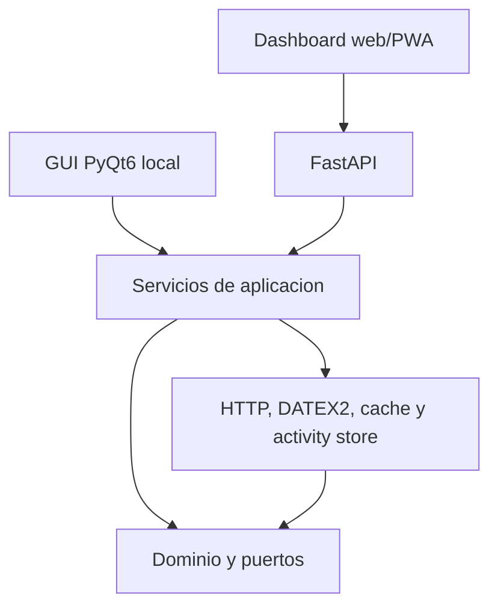
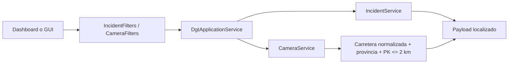

# Arquitectura

## Regla de dependencias

`core` no importa PyQt6, FastAPI ni requests. `infrastructure` implementa los puertos del dominio. `application` orquesta los casos de uso. `api`, `dashboard` y `gui` solo adaptan entradas y salidas.

El dashboard web consume la API desde el mismo origen y no contiene reglas DATEX2. Sus filtros se traducen a parametros HTTP y despues a `IncidentFilters` o `CameraFilters`; la semantica de busqueda, cobertura y distancia vive en `application`/`core`. La GUI de escritorio es local-only: Render ejecuta el dashboard/API, no PyQt6.

## Flujo de filtros y cobertura

`match_mode` se mantiene dentro de los filtros hasta los servicios. `contains` es el modo por defecto, `exact` exige igualdad completa y `regex` permite expresiones regulares sin distinguir mayusculas. El filtro `incident_coverage` de camaras se resuelve en la fachada para poder consultar incidencias activas y camaras con el mismo criterio de cobertura.

## Localizacion e idiomas

El dominio conserva identificadores y variables técnicas en inglés. Los códigos DATEX2 no se muestran directamente en las interfaces: `dgt_monitor.core.localization.Translator` los convierte a etiquetas de presentación y la fachada añade campos `*_label` al payload de incidencias. El parámetro `lang` permite seleccionar idioma (`es` por defecto, `en` soportado) sin cambiar filtros ni modelos base.

Cuando un código de DGT no está en el catálogo, el traductor aplica un fallback legible a partir del nombre técnico para evitar camelCase o valores crudos en dashboard, API y GUI.

## Dashboard y PWA

El dashboard usa scroll general de pagina para navegacion movil/escritorio y scroll interno en superficies densas. El service worker cachea el shell versionado (`dgt-monitor-v51`) y evita cachear `/api/` para no presentar datos de trafico obsoletos. El mapa no introduce reglas propias: combina el payload de incidencias con camaras relacionadas calculadas por los mismos servicios que usan las otras pestanas.
