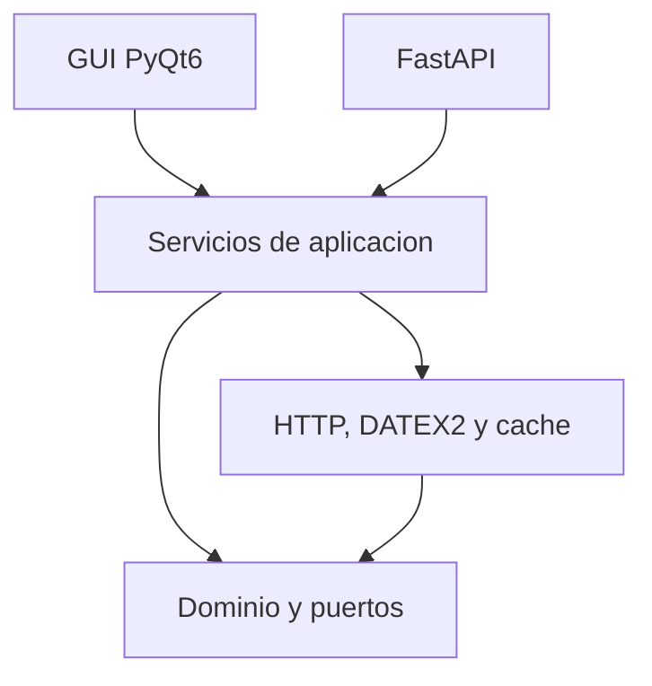

# Arquitectura

## Regla de dependencias

`core` no importa PyQt6, FastAPI ni requests. `infrastructure` implementa los puertos del dominio. `application` orquesta los casos de uso. `api` y `gui` solo adaptan entradas y salidas.
