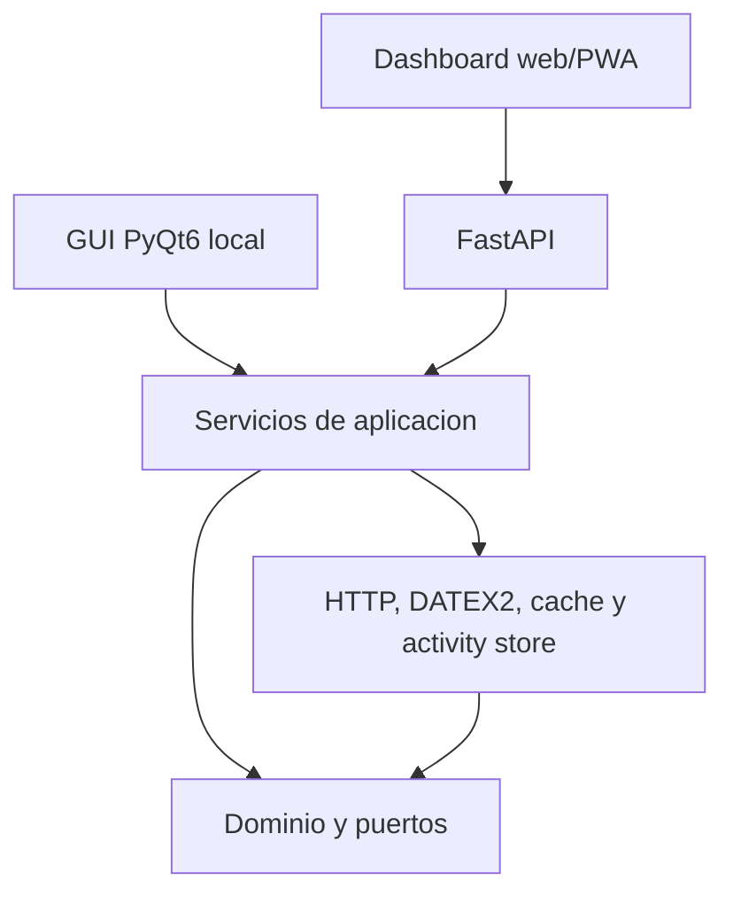

# Arquitectura

## Regla de dependencias

`core` no importa PyQt6, FastAPI ni requests. `infrastructure` implementa los puertos del dominio. `application` orquesta los casos de uso. `api`, `dashboard` y `gui` solo adaptan entradas y salidas.

El dashboard web consume la API desde el mismo origen y no contiene reglas DATEX2. La GUI de escritorio es local-only: Render ejecuta el dashboard/API, no PyQt6.

## Localizacion e idiomas

El dominio conserva identificadores y variables técnicas en inglés. Los códigos DATEX2 no se muestran directamente en las interfaces: `dgt_monitor.core.localization.Translator` los convierte a etiquetas de presentación y la fachada añade campos `*_label` al payload de incidencias. El parámetro `lang` permite seleccionar idioma (`es` por defecto, `en` soportado) sin cambiar filtros ni modelos base.

Cuando un código de DGT no está en el catálogo, el traductor aplica un fallback legible a partir del nombre técnico para evitar camelCase o valores crudos en dashboard, API y GUI.
