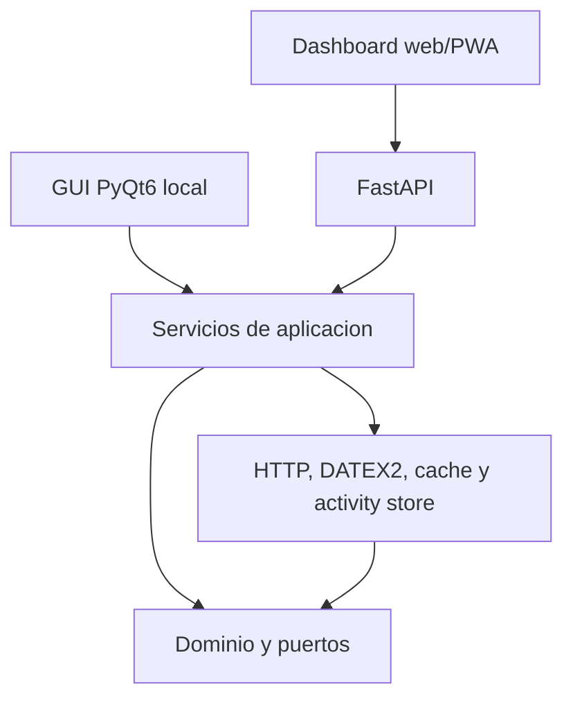

# Arquitectura

## Regla de dependencias

`core` no importa PyQt6, FastAPI ni requests. `infrastructure` implementa los puertos del dominio. `application` orquesta los casos de uso. `api`, `dashboard` y `gui` solo adaptan entradas y salidas.

El dashboard web consume la API desde el mismo origen y no contiene reglas DATEX2. La GUI de escritorio es local-only: Render ejecuta el dashboard/API, no PyQt6.
