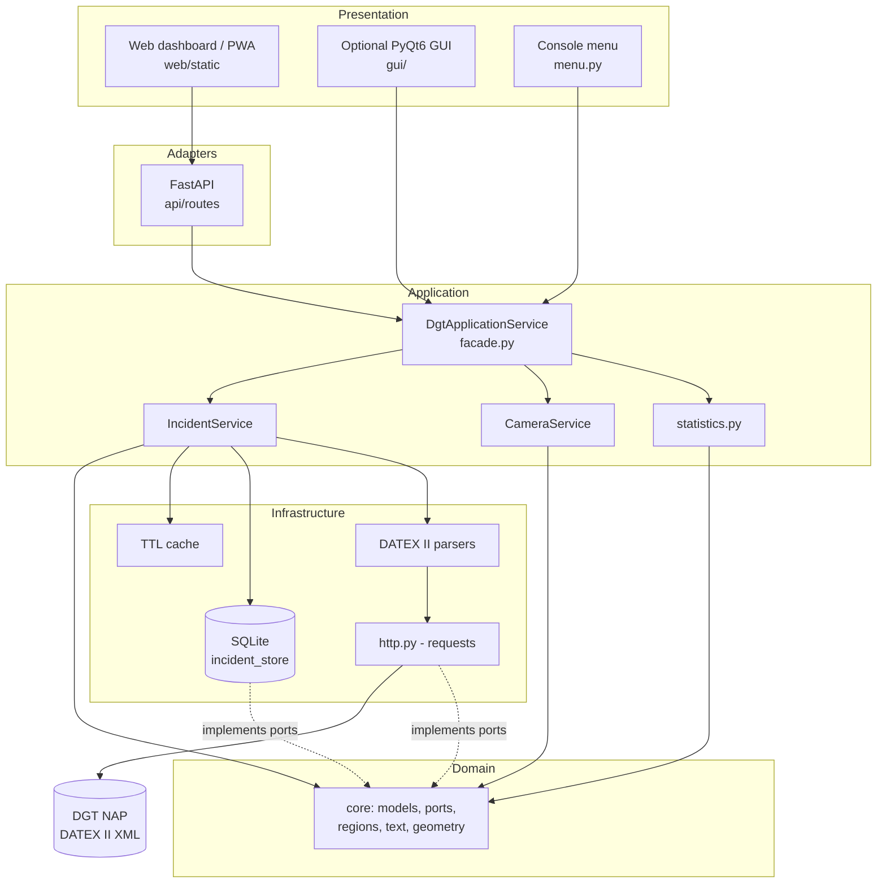
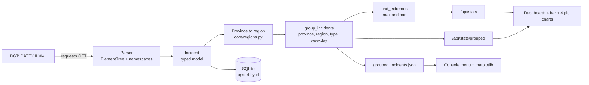
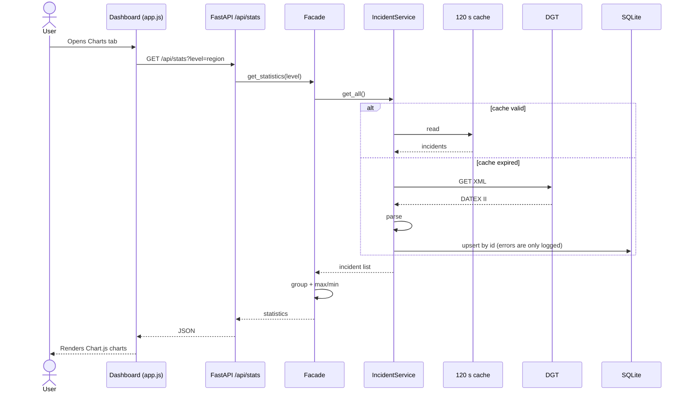
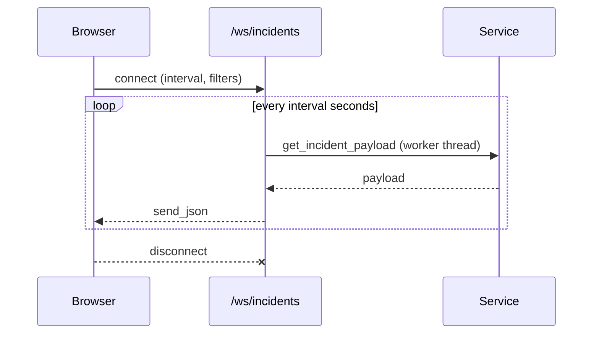
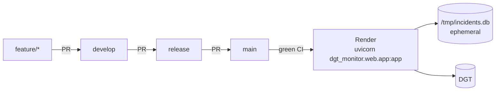

# Architecture and flow diagrams

All diagrams use Mermaid (rendered by GitHub and VS Code).

## 1. Layered architecture

Rule: `core` never imports FastAPI, PyQt6 or requests; outer layers depend inwards.

## 2. Data flow: from the DGT to the dashboard

## 3. Request sequence

## 4. Real time (WebSocket)

## 5. Deployment

On Render's free plan the disk is not persistent: the database is rebuilt from the DGT on the first request.
