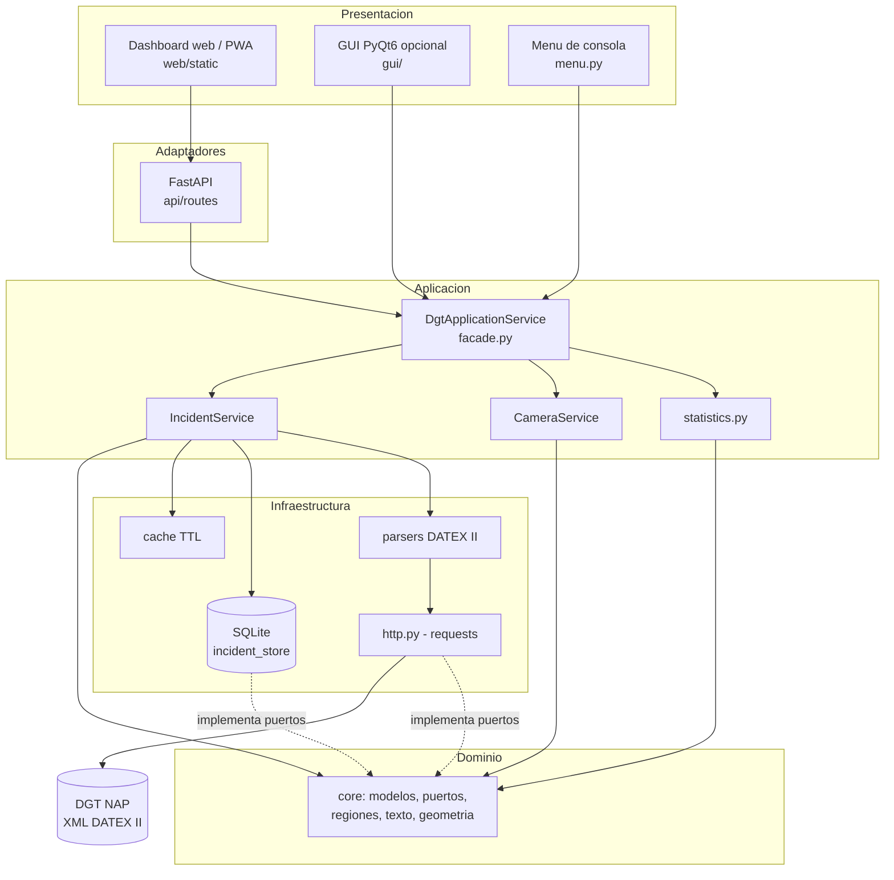
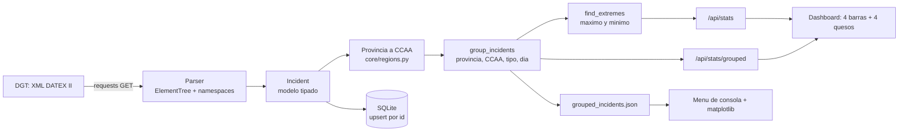
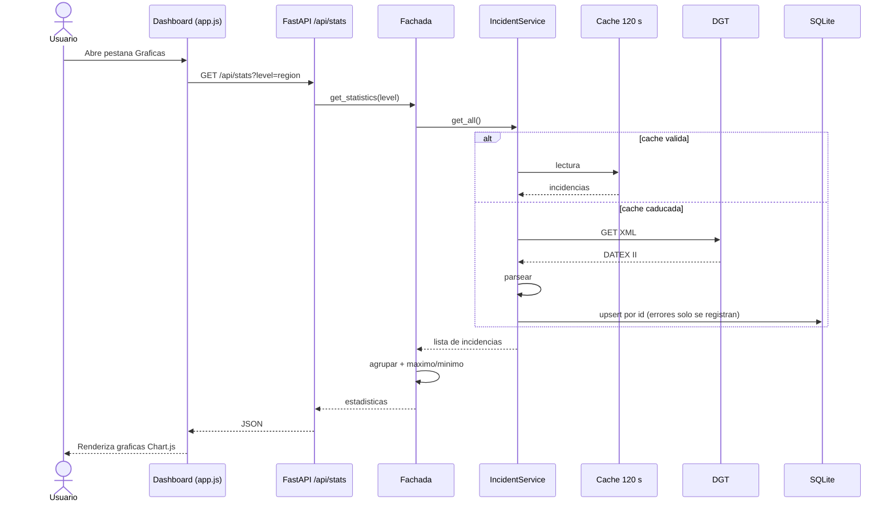
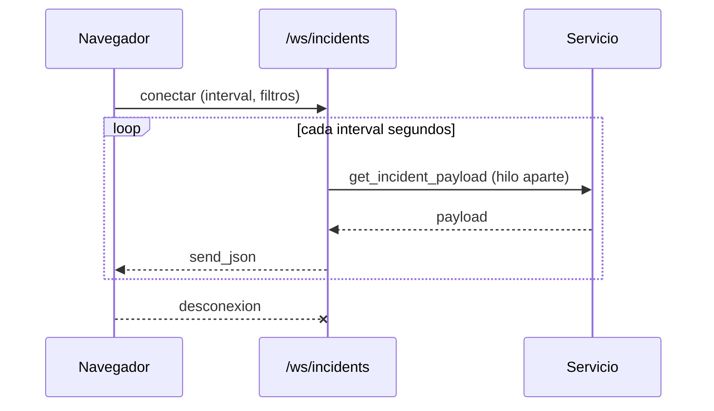
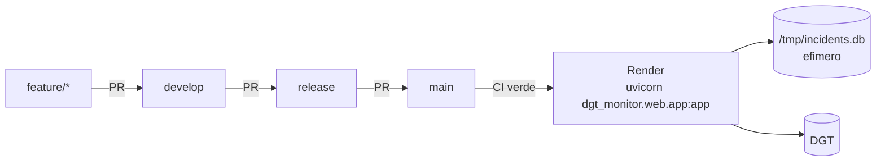

# Diagramas de arquitectura y flujo

Todos los diagramas usan Mermaid (se renderizan en GitHub y VS Code).

## 1. Arquitectura por capas

Regla: `core` no importa FastAPI, PyQt6 ni requests; las capas externas dependen hacia dentro.

## 2. Flujo de datos: de la DGT al dashboard

## 3. Secuencia de una peticion

## 4. Tiempo real (WebSocket)

## 5. Despliegue

En el plan gratuito de Render el disco no es persistente: la base se recrea desde la DGT en la primera peticion.
